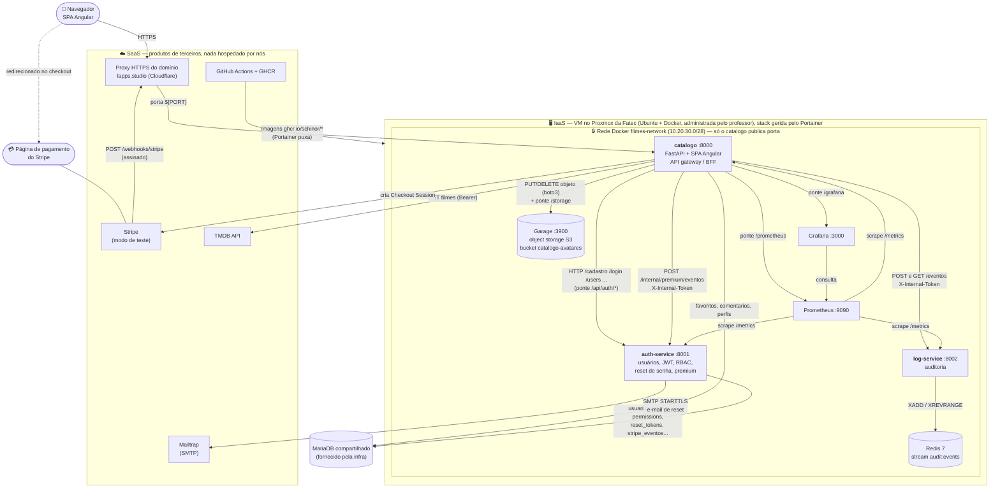
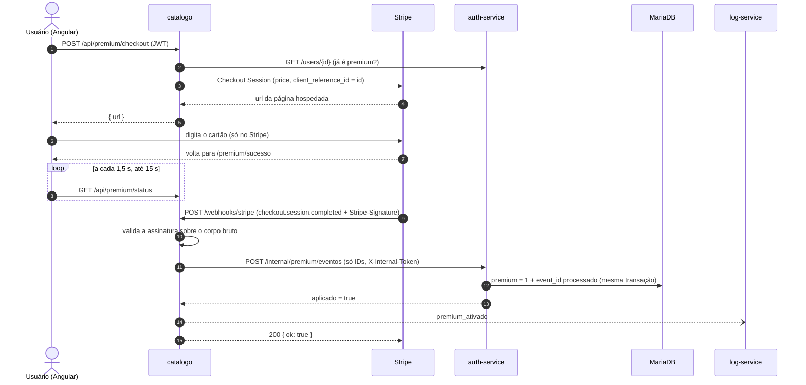
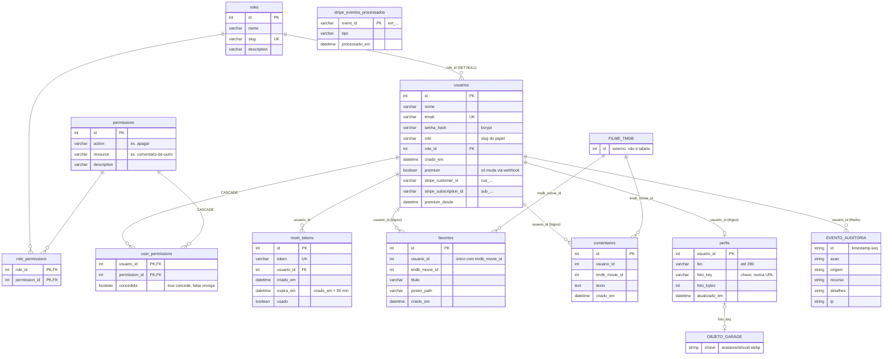

# 📘 HANK+ — Documentação reversa do sistema

> **Atividade 8 (encerramento da série).** Este documento descreve o HANK+ **como ele está hoje**, escrito como se eu tivesse acabado de herdar o código de outra pessoa. Nenhuma linha de código foi alterada para escrevê-lo: tudo aqui foi extraído **lendo o código** (branch `feat-implementando-stripe`, commit `23c9f6b`, a versão mais completa do sistema, com as Atividades 2 a 7).
>
> Disciplina de Cloud — Professor [@siriani](https://github.com/siriani) · Voltar ao [README](README.md)

**Sumário**

1. [Especificação — o que o sistema faz](#1-especificação--o-que-o-sistema-faz)
2. [Arquitetura — o big picture](#2-arquitetura--o-big-picture)
3. [Regras de negócio — "se X, então Y"](#3-regras-de-negócio--se-x-então-y)
4. [Modelo de dados](#4-modelo-de-dados)
5. [Observações de quem herdou o código](#5-observações-de-quem-herdou-o-código)

---

## 1. Especificação — o que o sistema faz

O **HANK+** é um catálogo web dos filmes do ator Tom Hanks. Os dados dos filmes vêm da API pública do **TMDB**; por cima deles, o sistema oferece contas de usuário, favoritos, comentários, perfil com foto, um plano pago (Premium) e uma trilha de auditoria para o administrador.

### 1.1 Quem usa o sistema

| Ator | Como chega | O que pode fazer (resumo) |
|---|---|---|
| **Visitante** | Abre o site sem login | Ver a landing page e os planos, criar conta, pedir recuperação de senha. A API de filmes é pública, mas a tela do catálogo exige login. |
| **Usuário comum** | Faz login | O que o **plano** dele liberar (ver tabela abaixo): navegar no catálogo, favoritar, comentar, editar o próprio perfil e foto. |
| **Usuário Premium** | Pagou a assinatura no Stripe | Tudo do plano dele, **sem o limite de 5 favoritos**, com selo ★ Premium no perfil. |
| **Administrador** | Papel `admin` (não pode ser escolhido no cadastro) | Tudo, mais: gerenciar usuários (trocar plano, ajustar permissões, remover), moderar comentários de qualquer um e consultar a auditoria. |
| **Stripe** (sistema externo) | Chama o webhook | Avisa que um pagamento foi concluído ou que uma assinatura foi cancelada. |

Os "planos" de usuário comum são papéis RBAC com nomes de filmes do Tom Hanks:

| Plano (slug) | Nome exibido | O que libera |
|---|---|---|
| `amigo-do-wilson` | Amigo do Wilson (Náufrago) | Ver catálogo, detalhes dos filmes e comentários. **Plano padrão.** |
| `preso-no-terminal` | Preso no Terminal (O Terminal) | O anterior + listar, adicionar e remover favoritos. |
| `houston-temos-acesso` | Houston, Temos Acesso (Apollo 13) | O anterior + comentar e apagar os próprios comentários. |
| `capitao-hanks` | Capitão Hanks (Capitão Phillips) | O anterior + a permissão `assistir:catalogo-premium`. |
| `admin` | Admin | Todas as 16 permissões, incluindo `administrar:sistema`. |

> ⚠️ "Plano" (papel RBAC) e "Premium" (assinatura paga) são coisas **diferentes** no código: o plano decide *quais ações* o usuário pode fazer; o Premium só remove o limite de favoritos. Um `houston-temos-acesso` pode ser Premium, e um `capitao-hanks` pode não ser.

### 1.2 Funcionalidades, do ponto de vista de quem usa

**Cadastro e login** (`/login`)
- A mesma tela tem três modos: entrar, criar conta e "esqueci minha senha".
- No cadastro, o usuário informa nome, e-mail e senha. O plano vem da landing page (`/login?role=<slug>`); sem escolha, ele vira `amigo-do-wilson`.
- Ao entrar, o usuário recebe um token (JWT) válido por 24 h, guardado no navegador. Recarregar a página mantém a sessão.
- "Sair" encerra a sessão no navegador e registra o logout na auditoria.

**Recuperação de senha** (`/login` → "esqueci minha senha" e `/reset-password?token=...`)
- O usuário informa o e-mail e sempre vê a mesma mensagem neutra ("se o e-mail estiver cadastrado, enviaremos um link…"), exista a conta ou não.
- Chega um e-mail (via Mailtrap) com um link que vale **30 minutos** e **uma única vez**. A página do link valida o token antes de mostrar o formulário da nova senha.

**Catálogo de filmes** (`/catalogo`)
- Lista todos os filmes em que Tom Hanks atuou, com pôster. Clicar abre um modal com sinopse e ficha técnica (detalhes vindos do TMDB).
- No modal, conforme o plano: botão de favoritar, comentários do filme, campo para comentar e lixeira nos comentários que o usuário pode apagar.

**Favoritos** (`/favoritos`, exige `listar:favoritos`)
- Lista os filmes favoritados pelo próprio usuário.
- Mostra o contador "N/5 favoritos" para quem não é Premium e o botão de assinar.

**Comentários** (`/comentarios`, exige `listar:comentarios`)
- Mural com os comentários de toda a comunidade, dos mais recentes para os mais antigos.

**Perfil** (`/perfil` e `/perfil/:id`)
- Mostra nome, bio, foto, favoritos e o selo ★ Premium.
- Qualquer usuário logado pode **ver** o perfil de qualquer outro.
- Só o dono pode **editar** a bio (até 280 caracteres) e enviar, trocar ou remover a foto (JPEG, PNG ou WEBP de até 2 MB; o sistema a converte para um quadrado 512×512).

**Plano Premium** (`/premium/sucesso`, `/premium/cancelado`)
- "Assinar Premium" (R$ 9,90/mês, Stripe em **modo de teste**) leva o usuário à página de pagamento hospedada pelo Stripe. O cartão é digitado **só** lá.
- Ao voltar, a página de sucesso mostra "Processando pagamento…" e espera até 15 s a confirmação chegar pelo webhook. Ao confirmar, o limite de favoritos some e o selo aparece no perfil.

**Gestão de usuários** (`/usuarios`, exige `gerenciar:usuarios`, na prática só admin)
- Lista todos os usuários, troca o plano de um usuário, liga e desliga permissões individuais e remove contas (junto com favoritos, comentários, perfil e foto).

**Auditoria** (`GET /api/logs`, exige `visualizar:logs`, só admin)
- Mostra os últimos eventos (padrão 50, máximo 500): logins, logins que falharam, logouts, favoritos, comentários, mudanças de perfil, ações administrativas, eventos do Premium e **toda** tentativa de acesso negado.

**Observabilidade** (para quem opera o sistema)
- `/health` de cada serviço, `/metrics` no formato Prometheus, e os painéis em `/grafana` (login próprio) e `/prometheus` (protegido por senha).

### 1.3 Endpoints públicos da API (todos passam pelo catálogo)

| Grupo | Rotas | Autenticação |
|---|---|---|
| Autenticação | `POST /api/auth/cadastro`, `POST /api/auth/login`, `POST /api/auth/logout`, `GET /api/auth/me`, `POST /api/auth/forgot-password`, `GET /api/auth/validate-reset-token/{token}`, `POST /api/auth/reset-password` | Pública, exceto `logout` e `me` (JWT) |
| Gestão (admin) | `GET /api/auth/users`, `PUT /api/auth/users/{id}/role`, `PUT /api/auth/users/{id}/permissions`, `DELETE /api/auth/users/{id}`, `POST /api/auth/roles`, `GET /api/auth/permissions`, `GET /api/auth/admin/status` | JWT + permissão |
| Papéis | `GET /api/auth/roles`, `GET /api/auth/users/{id}/role` | Pública |
| Filmes | `GET /api/filmes`, `GET /api/filmes/{id}` | Pública |
| Favoritos | `GET /api/favoritos`, `POST /api/favoritos`, `DELETE /api/favoritos/{tmdb_movie_id}` | JWT + permissão |
| Comentários | `GET /api/comentarios`, `GET /api/comentarios/{tmdb_movie_id}`, `POST /api/comentarios`, `DELETE /api/comentarios/{id}` | JWT + permissão |
| Perfis | `GET /api/perfis/me`, `GET /api/perfis/{id}`, `PUT /api/perfis/{id}`, `PUT /api/perfis/{id}/foto`, `DELETE /api/perfis/{id}/foto` | JWT (edição só pelo dono) |
| Premium | `GET /api/premium/status`, `POST /api/premium/checkout` | JWT |
| Webhook | `POST /webhooks/stripe` | Assinatura `Stripe-Signature` |
| Auditoria | `GET /api/logs` | JWT + `visualizar:logs` |
| Infra | `/health`, `/metrics`, `/storage/*`, `/grafana/*`, `/prometheus/*`, `/api/docs` | Variada (ver regras R55–R58) |

---

## 2. Arquitetura — o big picture

### 2.1 Diagrama

### 2.2 Os serviços

| Serviço | Imagem | Porta / exposição | Responsabilidade | Fala com |
|---|---|---|---|---|
| **catalogo** | `ghcr.io/schinor/catalogo-filmes` | `${PORT}:8000` — **único com porta publicada** | Serve a SPA Angular; API de filmes, favoritos, comentários, perfis, premium e logs; faz *ponte* (proxy) para auth-service, Garage, Grafana e Prometheus; ponto central da auditoria | auth-service, log-service, Garage, MariaDB, TMDB, Stripe |
| **auth-service** | `ghcr.io/schinor/auth-service` | `expose: 8001` (só rede interna) | Dono da tabela `usuarios`: cadastro, login, JWT, RBAC, recuperação de senha, gravação do status Premium | MariaDB, Mailtrap |
| **log-service** | `ghcr.io/schinor/log-service` | `expose: 8002` | Recebe e lista eventos de auditoria | Redis |
| **redis** | `redis:7-alpine` (AOF ligado) | nenhuma | Guarda o stream `audit:events` (máx. ~100 mil eventos) | — |
| **garage** | `ghcr.io/schinor/garage` | `expose: 3900` | Object storage compatível com S3; guarda as fotos de perfil | — |
| **prometheus** | `ghcr.io/schinor/prometheus` | `expose: 9090` | Coleta `/metrics` de catalogo, auth-service e log-service | — |
| **grafana** | `ghcr.io/schinor/grafana` | `expose: 3000` | Painel "hanks-plus" com as métricas | Prometheus |

Fora da stack: o **MariaDB** (o catálogo e o auth-service recebem a mesma `DATABASE_URL` e usam tabelas diferentes no mesmo banco) e os serviços SaaS da figura.

### 2.3 Como as peças conversam

- **Um único ponto de entrada.** O navegador só fala com o `catalogo`. Tudo o que é interno (auth-service, log-service, Redis, Garage, Prometheus, Grafana) não tem `ports:` no compose e só é alcançado pela rede `filmes-network`. Quando o navegador precisa de algo interno, o catálogo faz uma *ponte*: `/api/auth/*` → auth-service, `/storage/*` → Garage, `/grafana/*` → Grafana, `/prometheus/*` → Prometheus.
- **Autorização local por JWT (Padrão B).** O auth-service assina o JWT (HS256) com `sub`, `nome`, `email`, `role` e `permissions`. O catálogo tem a mesma `SECRET_KEY` e valida o token **sem chamar ninguém**; se a decodificação local falhar, tenta `GET /me` no auth-service.
- **Exceção: o status Premium.** Ele **nunca** é lido do JWT. O catálogo consulta `GET /users/{id}` no auth-service sempre que precisa saber se o usuário é Premium.
- **Tokens internos.** Catálogo → log-service usa `X-Internal-Token` (`LOG_INTERNAL_TOKEN`); catálogo → `/internal/premium/eventos` do auth-service usa `X-Internal-Token` (`AUTH_INTERNAL_TOKEN`). Ambos são comparados em tempo constante.
- **Arquivos fora do banco.** A foto vai para o Garage; o banco guarda só a *chave* do objeto. Para exibir, o catálogo gera uma URL pré-assinada que expira e a reescreve para `/storage/...`, que repassa a requisição intacta ao Garage. Quem valida assinatura e expiração é o Garage.
- **Auditoria assíncrona e tolerante a falha.** As rotas disparam o evento em *background* (timeout de 1,5 s); se o log-service cair, a ação do usuário continua funcionando.
- **Entrega contínua.** `git push` → GitHub Actions (pytest + stack de CI com `--wait`) → seis imagens no GHCR (`sha-<commit>` e `latest`) → o Portainer puxa e recria a stack.

### 2.4 Fluxo que cruza mais peças: assinatura Premium

---

## 3. Regras de negócio — "se X, então Y"

Cada regra aponta o arquivo onde o código a impõe. `catalogo` = `backend/app`, `auth` = `auth-service/app`.

### 3.1 Cadastro, login e sessão

| # | Regra | Onde |
|---|---|---|
| R01 | Se o e-mail já está cadastrado, então o cadastro é recusado com **400** ("E-mail já cadastrado"). O e-mail é sempre gravado e comparado em minúsculas e sem espaços. | `auth/routes/auth.py` (`cadastro`), `auth/repositories/usuario_repo.py` |
| R02 | Se o cadastro público pede o papel `admin`, então é recusado com **403** (e gera `acesso_negado` na auditoria). | `auth/routes/auth.py`, `catalogo/main.py` |
| R03 | Se o cadastro não informa papel, ou informa um papel que não existe, então o usuário vira `amigo-do-wilson`. Os nomes antigos `usuario` e `admin` são traduzidos para os slugs novos. | `auth/repositories/usuario_repo.py` (`create`, `LEGACY_ROLE_MAP`) |
| R04 | Se a senha tem mais de 72 bytes, então só os 72 primeiros contam (limite do bcrypt). A senha é guardada só como hash bcrypt com salt. | `auth/core/security.py` |
| R05 | Se e-mail ou senha estão errados, então o login responde **401** com a mesma mensagem nos dois casos ("E-mail ou senha incorretos") e registra `login_falhou` com o e-mail tentado. | `auth/routes/auth.py`, `catalogo/routes/auth.py` |
| R06 | Se o login dá certo, então o usuário recebe um JWT HS256 válido por `ACCESS_TOKEN_EXPIRE_MINUTES` (padrão **1440 min = 24 h**), com `sub`, `email`, `nome`, `role` e `permissions`, e é registrado `login`. | `auth/core/security.py`, `auth/routes/auth.py` |
| R07 | Se o usuário faz logout, então só é registrado `logout`: o JWT não é invalidado no servidor e continua válido até expirar. | `catalogo/routes/auth.py` (`logout`) |
| R08 | Se o papel ou as permissões de um usuário mudam, então as rotas do catálogo só enxergam a mudança **depois de um novo login** (as permissões vivem no JWT). | `catalogo/dependencies.py` (`current_user`) |

### 3.2 Recuperação de senha

| # | Regra | Onde |
|---|---|---|
| R09 | Se alguém pede recuperação, então a resposta é **sempre a mesma mensagem neutra** — exista o e-mail ou não, tenha o envio falhado ou não. | `auth/routes/auth.py` (`forgot_password`) |
| R10 | Se o usuário já pediu `RESET_REQUEST_LIMIT` (**3**) links nos últimos `RESET_REQUEST_WINDOW_MINUTES` (**15 min**), então nenhum token novo é criado nem enviado (a resposta continua neutra). | `auth/routes/auth.py`, `auth/repositories/reset_token_repo.py` |
| R11 | Se o pedido é aceito, então é gerado um token aleatório (`secrets.token_urlsafe(32)`) que expira em **30 minutos** e é enviado por e-mail (SMTP com STARTTLS). | `auth/repositories/reset_token_repo.py`, `auth/core/email.py` |
| R12 | Se o token não existe, já expirou ou já foi usado, então a troca de senha é recusada com **400** (checados nessa ordem). | `auth/routes/auth.py` (`reset_password`) |
| R13 | Se a nova senha tem menos de **6 caracteres**, então a troca é recusada com **400**. | `auth/routes/auth.py` |
| R14 | Se a senha é trocada, então aquele token é marcado como `usado` e não serve mais. | `auth/routes/auth.py`, `reset_token_repo.mark_as_used` |
| R15 | Se o SMTP não está configurado, então o envio falha; só em desenvolvimento, com `EMAIL_LOG_LINK_WITHOUT_SMTP=true`, o link é escrito no log em vez de enviado. | `auth/core/email.py` |

### 3.3 Papéis e permissões (RBAC)

| # | Regra | Onde |
|---|---|---|
| R16 | Permissões têm o formato `ação:recurso`. As permissões **efetivas** de um usuário são: as do papel, **menos** as revogadas individualmente, **mais** as concedidas individualmente. | `auth/models/usuario.py` (`permissions`) |
| R17 | Se o usuário tem `administrar:sistema`, então ele passa em **qualquer** checagem de permissão (curinga), nos dois serviços. | `catalogo/dependencies.py`, `auth/core/security.py` (`require_permission`) |
| R18 | Se a rota exige uma permissão que o usuário não tem, então a resposta é **403** ("Acesso negado: permissão 'X' necessária"). | idem |
| R19 | Se o admin troca o plano de um usuário, então os ajustes individuais de permissão daquele usuário são **descartados**. | `auth/repositories/usuario_repo.py` (`update_role`) |
| R20 | Se o admin define as permissões de um usuário, então o banco grava **só a diferença** em relação ao papel (concessões e revogações). | `usuario_repo.set_permissions` |
| R21 | Se o admin informa um plano ou uma permissão que não existe, então recebe **400** ("Plano inexistente" / "Permissões inexistentes: …"). | `auth/routes/users.py` |
| R22 | Se o admin tenta alterar ou remover **a própria conta** pela gestão de usuários, então recebe **400**. | `auth/routes/users.py`, `catalogo/routes/auth.py` |
| R23 | Se o auth-service inicia, então o *seed* recria as 16 permissões e os 5 papéis do código e **reatribui todo usuário** ao papel do seu slug; usuário com papel desconhecido volta para `amigo-do-wilson`. | `auth/core/rbac_seed.py`, `auth/main.py` |
| R24 | Se o Angular esconde um botão ou bloqueia uma rota (`permissionGuard`, `*hasPermission`), isso é só interface: quem decide de verdade é o backend. | `frontend/src/app/guards`, `directives` |

### 3.4 Catálogo, favoritos e comentários

| # | Regra | Onde |
|---|---|---|
| R25 | Se alguém consulta `/api/filmes`, então recebe os créditos de filmes de Tom Hanks no TMDB, **sem precisar de login**; se o TMDB falhar, **502**. (A *tela* `/catalogo` exige login.) | `catalogo/routes/filmes.py`, `services/tmdb_service.py` |
| R26 | Um usuário só lista e remove os **próprios** favoritos: o `usuario_id` vem sempre do JWT, nunca do corpo da requisição. | `catalogo/routes/favoritos.py` |
| R27 | Se o filme já está nos favoritos do usuário, então **409** — checado antes do limite. A unicidade também é garantida no banco (`uq_usuario_filme`). | `catalogo/routes/favoritos.py`, `models/favoritos.py` |
| R28 | Se o usuário **não é Premium** e já tem `LIMITE_FAVORITOS_FREE` (**5**) favoritos, então o 6º é recusado com **403** e auditado com `recurso=favoritos:limite-free`. **Usuário Premium tem favoritos ilimitados.** | `catalogo/routes/favoritos.py` |
| R29 | Se o usuário tem menos favoritos que o limite, então o auth-service nem é consultado. Acima dele, o plano é lido **do banco**, nunca do JWT. | `catalogo/routes/favoritos.py`, `clients/auth_client.py` (`usuario_premium`) |
| R30 | Se o favorito a remover não existe, então **404**. | `catalogo/routes/favoritos.py` |
| R31 | Comentários são listados do mais recente para o mais antigo (todos ou por filme), para quem tem `listar:comentarios`. | `catalogo/repositories/comentario_repo.py` |
| R32 | Se o usuário é o autor **e** tem `apagar:comentario-proprio`, ou tem `apagar:comentario-de-outro`, ou tem `administrar:sistema`, então pode apagar o comentário; senão, **403** auditado. Ou seja: **só o admin apaga comentário de outro usuário**, e um autor sem `apagar:comentario-proprio` não apaga nem o próprio. | `catalogo/routes/comentarios.py` |
| R33 | Se o comentário não existe, então **404**. | idem |

### 3.5 Perfil e foto

| # | Regra | Onde |
|---|---|---|
| R34 | Qualquer usuário logado pode **ver** o perfil de qualquer outro (nome, bio, foto, favoritos, selo Premium). Usuário inexistente → **404**. | `catalogo/routes/perfis.py` |
| R35 | Se o `{usuario_id}` da rota é diferente do id do JWT, então editar bio ou foto é recusado com **403** — **inclusive para o admin**. Usuário comum só edita o próprio perfil. | `perfis.py` (`garantir_dono`) |
| R36 | Se a bio tem mais de 280 caracteres, então **422**; espaços nas pontas são removidos e bio vazia vira `null`. Um `usuario_id` enviado no corpo é ignorado. | `catalogo/schemas/perfil.py` |
| R37 | Se o arquivo da foto está vazio → **400**; passa de `PERFIL_FOTO_MAX_BYTES` (**2 MB**, conferido durante a leitura) → **413**; não é **de fato** JPEG, PNG ou WEBP (conferido pelos bytes, não pela extensão) ou passa de 25 megapixels → **415**. | `perfis.py` |
| R38 | Se a foto é aceita, então é regravada como WEBP 512×512 (sem EXIF) com uma chave gerada pelo servidor: `avatares/{id}/{uuid}.webp`. O nome original do arquivo nunca é usado. | `perfis.py` (`_reencodar_avatar`) |
| R39 | Se o usuário envia mais de **10 fotos em 1 minuto**, então **429**. | `perfis.py` (`_checar_limite_upload`) |
| R40 | Ao trocar a foto: primeiro o objeto vai para o storage (se falhar → **502** e o banco fica intocado); depois o banco (se falhar, o objeto novo é apagado); só então a foto antiga é apagada. | `perfis.py` (`enviar_foto`) |
| R41 | Ao remover a foto: primeiro o banco, depois o objeto. Remover sem ter foto também responde **204**. | `perfis.py` (`remover_foto`) |
| R42 | A URL da foto é pré-assinada e expira em: tempo de download a 256 kbps + 600 s de margem, com piso de **60 s** e teto de **1 h**. | `catalogo/services/storage.py` (`calcular_expiracao`) |
| R43 | Se uma URL de `/storage` chega sem assinatura → **403**; aponta para outro bucket → **404**; está expirada ou adulterada → o **403** do Garage é repassado. | `catalogo/routes/storage_proxy.py` |

### 3.6 Plano Premium (Stripe)

| # | Regra | Onde |
|---|---|---|
| R44 | Se a `STRIPE_SECRET_KEY` é uma chave **live** (`sk_live_`/`rk_live_`), então o catálogo **nem inicia**. Só modo de teste. | `catalogo/core/config.py` |
| R45 | Se as variáveis do Stripe não estão configuradas, então checkout e webhook respondem **503** e o resto do sistema segue funcionando. | `catalogo/routes/premium.py` |
| R46 | Se o usuário já é Premium, então o checkout é recusado com **409**; se o Stripe recusa, **502**. | idem |
| R47 | O status `premium` **só muda pelo webhook com assinatura válida**. Voltar para a `success_url` não altera nada. | `catalogo/routes/premium.py`, `auth/routes/premium.py` |
| R48 | Se o webhook chega sem `Stripe-Signature`, com corpo adulterado, segredo errado ou assinatura velha, então **400** e nada muda. | `catalogo/services/pagamentos.py` |
| R49 | Só dois eventos têm efeito: `checkout.session.completed` (com `mode=subscription`, pagamento `paid`/`no_payment_required` e `client_reference_id` numérico) **ativa** o Premium; `customer.subscription.deleted` **desativa**. Qualquer outro evento recebe **200** e é ignorado. | `catalogo/routes/premium.py` (`_recorte_do_evento`) |
| R50 | Se o mesmo `event_id` chega de novo (inclusive em paralelo), então nada é aplicado outra vez: o id do evento é gravado na **mesma transação** que muda o usuário. | `auth/routes/premium.py`, `models/stripe_evento.py` |
| R51 | Se chega o cancelamento de uma assinatura que não é a atual do usuário, então nada muda. | `auth/repositories/premium_repo.py` |
| R52 | Se o auth-service falha ao gravar, então o webhook responde **500** para o Stripe reenviar depois (a idempotência da R50 evita aplicar duas vezes). | `catalogo/routes/premium.py` |
| R53 | Do Stripe, o banco guarda **só IDs** (`stripe_customer_id`, `stripe_subscription_id`) e a data de ativação. Nenhum dado de cartão passa pelo sistema. | `auth/models/usuario.py` |
| R54 | Se a rota interna `/internal/premium/eventos` é chamada sem o `X-Internal-Token` correto → **401**; se o token não está configurado no auth-service → **503**. | `auth/routes/premium.py` |

### 3.7 Administração, auditoria e operação

| # | Regra | Onde |
|---|---|---|
| R55 | Se o admin remove um usuário, então o catálogo apaga **antes** os favoritos, comentários e o perfil dele, depois o auth-service apaga a conta (com tokens de reset e ajustes de permissão em cascata), e por fim a foto sai do bucket. | `catalogo/routes/auth.py` (`delete_user`) |
| R56 | **Toda** resposta 403 do catálogo — inclusive as que vêm repassadas do auth-service — gera o evento `acesso_negado`, com o usuário identificado pelo JWT. | `catalogo/main.py` (`auditar_403`), `dependencies.py` |
| R57 | Se o log-service está fora do ar, então a ação do usuário continua funcionando e o evento é perdido (só vira um *warning*). Consultar os logs com ele fora → **503**. | `catalogo/clients/log_client.py`, `routes/logs.py` |
| R58 | Só quem tem `visualizar:logs` (papel `admin`) consulta a auditoria; `limit` entre 1 e 500 (padrão 50), do mais recente para o mais antigo. O stream guarda no máximo ~100 mil eventos. | `catalogo/routes/logs.py`, `log-service/app/main.py` |
| R59 | Se `/prometheus` é acessado, então exige HTTP Basic (`admin` + `PROMETHEUS_PROXY_PASSWORD`); sem essa variável, **503**. O Grafana usa o próprio login. | `catalogo/routes/observability_proxy.py` |
| R60 | O `/health` do catálogo só responde **200** se banco, auth-service e Garage responderem; senão **503** (e o Docker marca o container como `unhealthy`). | `catalogo/main.py` |

---

## 4. Modelo de dados

O sistema guarda dados em **três lugares**: o MariaDB (dados estruturados), o Garage (arquivos de foto) e o Redis (trilha de auditoria). O MariaDB é um só, mas cada tabela tem **um serviço dono**.

### 4.1 Diagrama entidade-relacionamento

### 4.2 Tabelas e entidades

| Entidade | Onde vive | Dono | Papel no sistema |
|---|---|---|---|
| `usuarios` | MariaDB | auth-service | A conta: identificação, hash da senha, papel e **status Premium** (`premium`, IDs do Stripe, `premium_desde`). |
| `roles` / `permissions` / `role_permissions` | MariaDB | auth-service | Catálogo de papéis e permissões e a matriz entre eles. Preenchidas pelo *seed* a cada inicialização. |
| `user_permissions` | MariaDB | auth-service | Exceções por usuário: concede (`concedida = true`) ou revoga (`false`) uma permissão em relação ao papel. |
| `reset_tokens` | MariaDB | auth-service | Links de recuperação de senha (30 min, uso único). |
| `stripe_eventos_processados` | MariaDB | auth-service | Idempotência do webhook: cada `evt_...` aplicado uma vez só. |
| `favoritos` | MariaDB | catálogo | Filme favoritado por um usuário (único por par usuário + filme). |
| `comentarios` | MariaDB | catálogo | Texto de um usuário sobre um filme. |
| `perfis` | MariaDB | catálogo | Bio e **chave** da foto. Linha criada só na primeira edição; sem linha = bio vazia e sem foto. |
| Filme | API do TMDB | — | **Não existe tabela de filmes.** O sistema guarda só o `tmdb_movie_id` (e, nos favoritos, uma cópia do título e do pôster para exibir sem chamar o TMDB). |
| Foto de perfil | Garage, bucket `catalogo-avatares` | catálogo | Arquivo WEBP 512×512 em `avatares/{usuario_id}/{uuid}.webp`. |
| Evento de auditoria | Redis, stream `audit:events` | log-service | `usuario_id`, `acao`, `origem`, `timestamp`, `recurso`, `detalhes`, `ip`. O ID do stream já dá a ordem cronológica. |

### 4.3 Como os dados se relacionam (e o que não está amarrado)

- **Dentro do auth-service** as chaves estrangeiras existem de verdade: `usuarios.role_id → roles` (`SET NULL`), `user_permissions` e `role_permissions` em `CASCADE`, `reset_tokens.usuario_id → usuarios`.
- **Entre serviços** a relação é **lógica**: `favoritos`, `comentarios` e `perfis` têm `usuario_id`, mas os modelos do catálogo **não declaram FK** para `usuarios`, porque a tabela é de outro serviço. Quem garante a limpeza é a rota de remoção de usuário (R55). O código registra que o MariaDB de produção tem FK `RESTRICT` de `favoritos` e `comentarios` para `usuarios`, criada fora dos modelos — por isso o catálogo apaga os dados dele **antes** da conta.
- **"Sessão premium"** não é uma tabela. A sessão de checkout vive no Stripe; do nosso lado ficam as colunas de `usuarios` (o estado atual) e `stripe_eventos_processados` (o histórico de eventos já aplicados).
- **"Sessão de login"** também não é uma tabela: o JWT é *stateless* e não fica gravado em lugar nenhum.
- **Migrações.** O auth-service tem Alembic (`001` a `004`) **e**, ao iniciar, faz `create_all` mais alguns `ALTER TABLE` defensivos para bancos antigos. O catálogo cria as tabelas dele com `create_all`.

---

## 5. Observações de quem herdou o código

Ao ler o código para escrever este documento, apareceram pontos em que o comportamento real difere do que um leitor do README esperaria. Nada foi corrigido (a atividade pede só documentação); ficam registrados para quem for mexer depois.

1. **A permissão `assistir:catalogo-premium` não protege nada.** Ela existe no seed e no papel `capitao-hanks`, mas nenhuma rota do backend a exige. Hoje ela é só um rótulo.
2. **O cadastro público aceita qualquer plano que não seja `admin`.** Basta abrir `/login?role=capitao-hanks` (ou mandar `role` no corpo) para nascer com o plano mais alto de usuário comum. Só o `admin` é barrado (R02).
3. **`GET /api/auth/users/{id}/role` é público.** Sem login, qualquer pessoa consulta o papel e as permissões de qualquer id de usuário.
4. **O seed rebaixa papéis criados pela API.** Um papel criado em `POST /api/auth/roles` não está na lista do seed; na próxima reinicialização do auth-service, os usuários com esse papel voltam para `amigo-do-wilson` (R23).
5. **Permissões no JWT ficam velhas por até 24 h** (R08). Um usuário rebaixado continua com as permissões antigas no catálogo até o token expirar. O Premium não sofre disso porque é lido do banco (R29).
6. **Não há limite de tentativas de login.** Os únicos limites de taxa do código são o de pedidos de recuperação (3 em 15 min) e o de upload de foto (10 por minuto). Esse último fica **em memória, por processo**: reiniciar o container zera a contagem.
7. **A senha mínima de 6 caracteres só vale na redefinição** (R13). O cadastro não valida tamanho de senha, e o comentário não tem limite de tamanho.
8. **Tokens de reset antigos continuam valendo.** Usar um link marca só aquele token como usado; outros links pedidos antes dele seguem válidos até expirar.
9. **CORS liberado para qualquer origem** (`allow_origins=["*"]`) no catálogo e no auth-service.
10. **A contagem do limite de favoritos não é atômica.** Duas requisições simultâneas no 5º favorito podem passar as duas.
